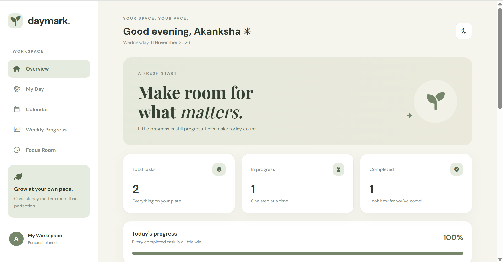
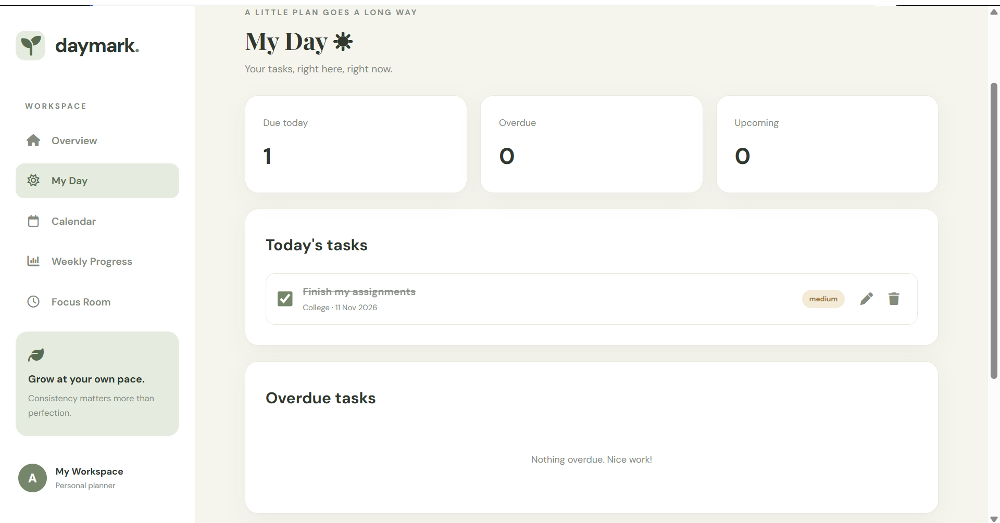
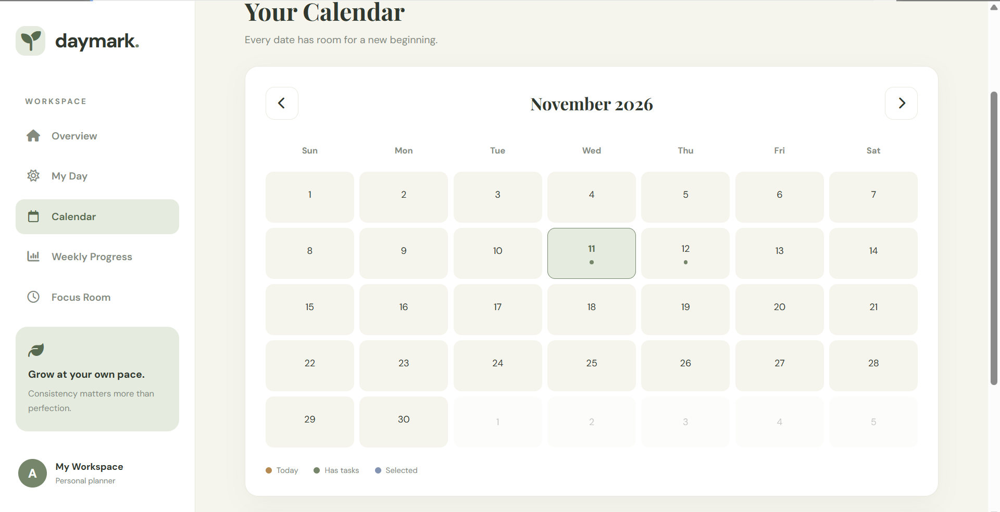
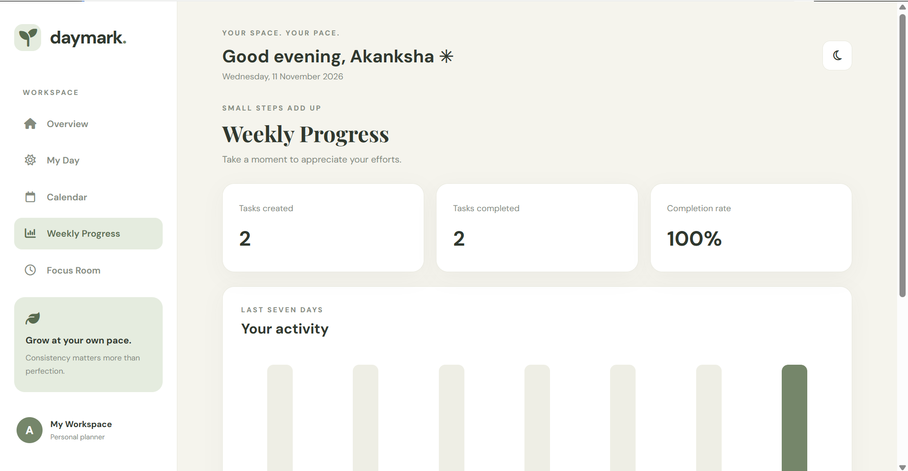
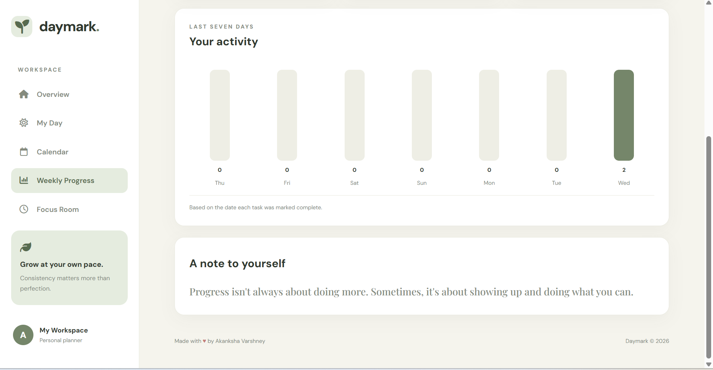
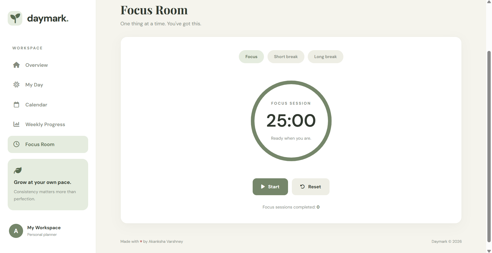

# 🌱 Daymark – Your Personal Productivity Planner

A minimal and thoughtfully designed productivity planner that helps you organize daily tasks, manage your schedule, track weekly progress, and stay focused.


## ✨ Features

- **Task Management:** Add, edit, delete, and mark tasks as completed.
- **My Day Planner:** Organize today's tasks and view overdue and upcoming tasks.
- **Interactive Calendar:** Navigate through dates and manage your schedule.
- **Weekly Progress:** Track completed tasks and visualize your productivity over the last seven days.
- **Focus Room:** Stay productive with a Pomodoro-style focus timer, short breaks, and long breaks.
- **Dark Mode:** Switch between light and dark themes.
- **Task Filtering:** Filter tasks by All, Pending, and Completed.
- **Search Tasks:** Quickly find tasks using the search feature.
- **Priority & Categories:** Organize tasks by priority and category.

## 🖥️ Screenshots
### Dashboard


### My Day


### Calendar


### Weekly Progress


### Weekly Progress Details


### Focus Room


## 🛠️ Technologies Used

- HTML5 – Structure
- CSS3 – Styling and responsive design
- JavaScript – Functionality and interactivity
- Local Storage – Persistent task data (if enabled in the implementation)

## 🚀 Getting Started

To run Daymark locally:

1. Clone the repository:

   ```bash
   git clone https://github.com/akankshavarshney15-dotcom/Daymark.git
   ```

2. Open the project folder.

3. Open `index.html` in your browser or use VS Code Live Server.

## 🌐 Live Website

Visit Daymark:

https://akankshavarshney15-dotcom.github.io/Daymark/

## 👩‍💻 Developer

**Akanksha Varshney**

B.Tech Computer Science & Engineering

## 📌 Project Purpose

Daymark was developed as a personal productivity project to practice frontend web development and create a simple, user-friendly task planning experience.

---

⭐ If you find this project interesting, consider giving it a star!
